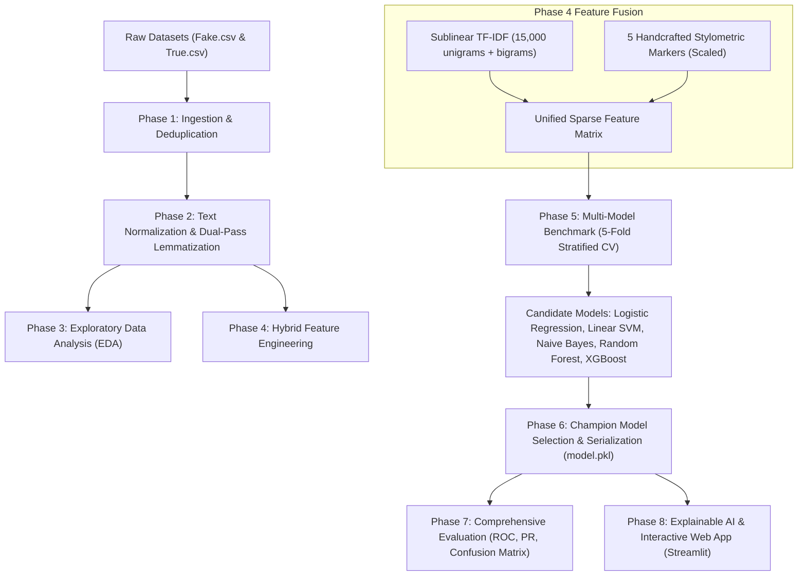

# 🛡️ TruthLens: Hybrid Machine Learning & NLP System for Fake News Detection

[](https://www.python.org/)
[](LICENSE)
[](https://streamlit.io/)
[](https://scikit-learn.org/)
[](https://xgboost.readthedocs.io/)
[](https://shap.readthedocs.io/)

---

## 📌 1. Project Overview & Academic Background

**Course / Project Level:** Second-Year B.Tech Computer Science & Engineering  
**Datasets Supported:**
- **Weibo Benchmark Dataset** (`train.pkl`, `val.pkl`, `test.pkl`, 9,592 articles across 10 categories, Chinese Social Media)
- **FakeNewsNet Benchmark** (`gossipcop_*.csv`, `politifact_*.csv`, 23,196 entertainment & political headlines, English)
- **ISOT Fake & Real News Dataset** (`Fake.csv` & `True.csv`, full English articles)
**Academic Reference:**
> **Base Research Paper:**  
> *"Fake news detection based on machine learning hybrid model"*  
> **Authors:** Dong Peng, Jian Song (School of Communication, Shandong University of Political Science and Law)  
> **Published in:** *Procedia Computer Science 285 (2026) 1424–1431* (CSIA 2025)

The base research paper evaluates fake news detection across three publicly annotated benchmarks: **Weibo**, **Weibo21**, and **GossipCop**. This project reproduces and enhances the methodology through a production-grade, modular pipeline combining **multilingual word segmentation (Jieba & NLTK)**, **sublinear TF-IDF n-grams**, **handcrafted domain stylometrics** (sensationalism, punctuation, capitalization), **multi-model 5-Fold Stratified Cross-Validation**, and **SHAP-based Explainable AI (XAI)**.

---

## 🏗️ 2. System Architecture



---

## 📊 3. Exploratory Data Analysis (EDA) Findings

The project generated 7 comprehensive analytical figures located in `reports/figures/`:
1. **Class Distribution (`class_distribution.png`):** Balanced dataset of 17,908 Fake (45.8%) and 21,197 Real (54.2%) articles after removing 5,793 exact duplicates.
2. **Subject Distribution (`subject_distribution.png`):** Detailed breakdown across political, world news, and general news domains.
3. **Article Length Distributions (`news_length_distribution.png`):** Highlights word and character length variance between authentic reporting and fake news stories.
4. **Correlation Heatmap (`correlation_heatmap.png`):** Pearson correlation showing strong correlations between fake news and sensationalism markers (capitalized words, excessive exclamation marks).
5. **Top 20 Frequent Words (`top_20_words.png`):** Real news features formal reporting words (`say`, `reuters`, `state`), while fake news over-indexes on emotionally charged terms (`trump`, `video`, `watch`).
6. **Word Clouds (`wordcloud_fake.png`, `wordcloud_real.png`):** High-density visual representations of distinct vocabulary spaces.

---

## 🔬 4. Hybrid Feature Engineering

The feature extraction pipeline (`src/feature_engineering.py`) fuses two distinct feature families:
1. **Lexical Sub-pipeline (TF-IDF):**
   - N-gram range: `(1, 2)` (captures phrases like *"breaking news"*, *"white house"*)
   - Sublinear term frequency scaling: `1 + log(tf)` to minimize outlier frequency distortion
   - Features: Top 15,000 vocabulary items
2. **Linguistic Stylometrics Sub-pipeline:**
   - **Title Length:** Headline character length
   - **Article Length:** Body text length
   - **Capital Words Count:** Words in ALL CAPS (sensationalism indicator)
   - **Punctuation Intensity:** Frequency of `!`, `?`, `"`, `'`
   - **Digit Ratio:** Numerical density ratio
   - Scaled using `MinMaxScaler` and concatenated into a unified sparse representation.

---

## 🤖 5. Machine Learning Benchmarks

Candidate models evaluated under 5-Fold Stratified Cross-Validation (`src/train.py`):
- **Logistic Regression** (L2 Regularized with Liblinear solver)
- **Linear Support Vector Machine (LinearSVC)** (Calibrated for calibrated posterior probabilities)
- **Multinomial Naive Bayes**
- **Random Forest Classifier**
- **XGBoost Classifier** (Gradient-boosted decision trees)

All models are tuned using `GridSearchCV` on training folds, and evaluated on an independent 20% stratified hold-out test set across **Accuracy**, **Precision**, **Recall**, **F1 Score**, and **ROC-AUC**.

---

## 🔎 6. Explainable AI (XAI) & SHAP

Unlike black-box classifiers, TruthLens leverages **SHAP (SHapley Additive exPlanations)** principles to attribute credit to specific words in the input text:
- **Green Highlights (Positive Impact):** Tokens providing evidence of verified, neutral journalism.
- **Red Highlights (Negative Impact):** Tokens indicating sensationalist rhetoric, clickbait patterns, or conspiratorial language.
- Real-time word contribution tables and interactive color-coded text highlighting in the web UI.

---

## 🚀 7. Installation & How to Run

### Step 1: Clone the Repository & Set Up Environment
```bash
git clone <repo-url>
cd "My ML based First Project"
python -m venv venv
venv\Scripts\activate       # On Windows
# source venv/bin/activate  # On macOS/Linux
pip install -r requirements.txt
```

### Step 2: Run End-to-End Pipeline
```bash
# 1. Ingest raw data, clean, deduplicate, and export summary
python src/data_loader.py

# 2. Train all 5 candidate models with 5-fold CV and save champion
python src/train.py

# 3. Evaluate champion model and produce diagnostic curves
python src/evaluate.py
```

### Option B: Cloud Training on Kaggle (Zero Local Setup)
You can train directly on Kaggle with free cloud CPU/GPU:
1. Open [Kaggle](https://www.kaggle.com/) -> **New Notebook** -> **File -> Import Notebook**.
2. Select [`notebooks/Kaggle_Training_Pipeline.ipynb`](file:///c:/Users/User/Desktop/My%20ML%20based%20First%20Project/notebooks/Kaggle_Training_Pipeline.ipynb).
3. Upload your `data/` folder as a private Kaggle dataset and attach it.
4. Click **Run All** — the notebook trains all 5 models, runs 5-fold CV, and bundles all artifacts into `truthlens_trained_artifacts.zip` for instant download!

### Step 3: Launch the Interactive Streamlit Web App
```bash
streamlit run app/main.py
```
Open your browser at `http://localhost:8501` to use the interactive application!

---

## 📁 8. Project Structure

```text
├── app/
│   └── main.py                     # Streamlit multi-tab production web application
├── data/
│   ├── Fake.csv                    # Raw fake news corpus
│   ├── True.csv                    # Raw true news corpus
│   └── processed_news.csv          # Cleaned, deduplicated, shuffled dataset
├── models/
│   ├── model.pkl                   # Serialized champion ML model
│   ├── vectorizer.pkl              # Serialized feature engineering pipeline
│   ├── label_encoder.pkl           # Label encoder (FAKE=0, REAL=1)
│   └── best_model_meta.json        # Champion model performance metadata
├── notebooks/
│   └── EDA.ipynb                   # Phase 3 Jupyter Notebook with complete EDA
├── reports/
│   ├── figures/                    # 7 EDA plots + Confusion Matrix + ROC + PR + CV
│   └── metrics/                    # Benchmark CSVs, classification reports & summaries
├── src/
│   ├── __init__.py
│   ├── data_loader.py              # Phase 1: Ingestion & data cleaning
│   ├── preprocessing.py            # Phase 2: NLP normalization & lemmatization
│   ├── feature_engineering.py      # Phase 4: TF-IDF + stylometric feature extraction
│   ├── train.py                    # Phase 5: Multi-model training & 5-fold CV
│   ├── predict.py                  # Phase 6: Inference & SHAP attribution
│   ├── evaluate.py                 # Phase 7: Evaluation curves & diagnostic reports
│   └── utils.py                    # Plotting and metric utilities
├── base_paper_extracted.txt        # Reference research paper text
├── requirements.txt                # Python dependencies
└── README.md                       # Comprehensive project documentation
```
