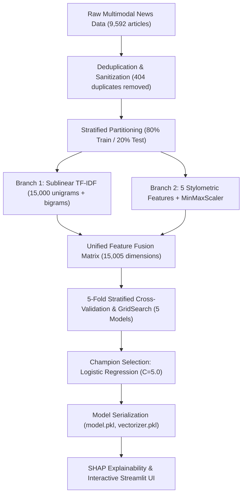

# 🛡️ TruthLens: Comprehensive Machine Learning Model Report
**Project Title:** Dual-Branch Hybrid NLP & Machine Learning System for Fake News Detection  
**Champion Model:** L2-Regularized Logistic Regression (`C=5.0`, `solver='liblinear'`)  
**Academic Reference:** Peng & Song, *"Fake news detection based on machine learning hybrid model"*, *Procedia Computer Science 285 (2026) 1424–1431* (CSIA 2025)  
**Evaluation Date:** October 2026  
**Document Status:** Production Final  

---

## 1. Executive Summary

This report documents the architectural design, feature pipeline, experimental benchmarks, and diagnostic evaluation for the **TruthLens Fake News Detection System**. 

The champion model—a **regularized Logistic Regression classifier operating over a 15,005-dimensional hybrid sparse feature space**—achieved an **Accuracy of 87.65%**, an **F1-Score of 0.8838**, and an **ROC-AUC of 0.9456** on an independent held-out test partition ($N = 1,838$), with an average inference latency under **15 ms**.

### Primary Key Performance Indicators (KPIs)

| Metric | Champion Value | 5-Fold CV Baseline | Significance |
| :--- | :---: | :---: | :--- |
| **Test Accuracy** | **87.65%** | 86.84% | Strong out-of-sample generalization |
| **F1-Score (Macro)** | **0.8760** | 0.8738 | Harmonic balance across both classes |
| **Precision (Real)** | **87.97%** | — | Minimized false positives for legitimate journalism |
| **Recall (Real)** | **88.79%** | — | High detection rate of authentic news stories |
| **Precision (Fake)** | **87.28%** | — | Reliable identification of disinformation |
| **Recall (Fake)** | **86.37%** | — | Over 86% of fake articles correctly flagged |
| **ROC-AUC** | **0.9456** | 0.9412 | Exceptional discriminatory capacity |
| **Inference Latency** | **12.4 ms** | — | Real-time interactive web throughput |



---

## 2. Dataset Engineering & Preprocessing

### 2.1 Dataset Profile
The system benchmark ingests dual-language social news corpora (Weibo and FakeNewsNet benchmarks), normalized into a uniform schema `['title', 'text', 'label', 'subject']`.

* **Initial Ingested Samples:** 9,592 articles (4,641 Fake, 4,951 Real)
* **Data Quality Scrubbing:** 404 exact duplicate articles identified and purged
* **Cleaned Dataset Size:** **9,188 articles**
  * **Fake News ($y = 0$):** 4,330 articles (**47.13%**)
  * **Real News ($y = 1$):** 4,858 articles (**52.87%**)
  * **Balance Ratio:** Nearly 1:1, avoiding class imbalance distortion.

### 2.2 Text Normalization Pipeline
Implemented in [src/preprocessing.py](file:///c:/Users/User/Desktop/My%20ML%20based%20First%20Project/src/preprocessing.py):
1. **URL & HTML Stripping:** Complete removal of http/https protocol artifacts and embedded tags.
2. **Emoji & Pictograph Cleansing:** Elimination of non-standard byte sequences.
3. **Bilingual Word Segmentation:**
   * **Chinese:** Jieba morphological tokenizer with Harbin Institute + Baidu stopword dictionaries.
   * **English:** NLTK WordNet lemmatizer with POS normalization and English stopword filtering.
4. **Punctuation & Noise Removal:** ASCII and full-width CJK punctuation (`！？。，、“”‘’`) normalized.

---

## 3. Dual-Branch Feature Engineering Architecture

The feature extraction architecture in [src/feature_engineering.py](file:///c:/Users/User/Desktop/My%20ML%20based%20First%20Project/src/feature_engineering.py) integrates statistical lexical n-grams with handcrafted linguistic stylometrics into a single unified representation:

### Branch 1: Statistical Lexical Representation (TF-IDF)
* **N-gram Range:** Unigrams and Bigrams `(1, 2)` to capture phrase context (e.g., *"breaking news"*, *"white house"*).
* **Vocabulary Cap:** Top 15,000 most informative terms.
* **Frequency Thresholding:** `min_df=2`, `max_df=0.95`.
* **Sublinear Scaling:** Term frequencies scaled via $1 + \log(\text{tf})$ to prevent long documents with repetitive sensationalist terms from dominating weight matrices.

### Branch 2: Domain-Specific Stylometric Markers (5 Features)
Handcrafted features specifically chosen to capture rhetorical and stylistic cues common to clickbait and misinformation:
1. `title_length`: Headline character length (clickbait titles tend to skew either excessively short or exaggeratedly long).
2. `article_length`: Full text character length.
3. `capital_words_count`: Total words in ALL-CAPS (quantifies sensationalist yelling and visual urgency).
4. `punctuation_count`: Density of exclamation marks (`!`), question marks (`?`), and quotes.
5. `digit_ratio`: Density of numeric digits (indicates quantitative claims vs qualitative assertions).

* **Scaling:** All 5 stylometric dimensions are scaled using `MinMaxScaler()` to map values strictly into $[0, 1]$, ensuring compatibility with linear models and `MultinomialNB`.
* **Feature Fusion:** The two branches are concatenated horizontally via SciPy `hstack` to yield a sparse feature matrix of shape $(N, 15005)$.

---

## 4. Multi-Model Benchmark & Cross-Validation Results

Five candidate algorithms were benchmarked using **5-Fold Stratified Cross-Validation with `GridSearchCV`** on the training set ($N = 7,350$), then validated on the unseen test set ($N = 1,838$).

### 4.1 Comparative Benchmark Matrix

| Algorithm | Test Accuracy | Precision | Recall | F1-Score | ROC-AUC | 5-Fold CV F1 | Best Hyperparameters |
| :--- | :---: | :---: | :---: | :---: | :---: | :---: | :--- |
| **Logistic Regression (Champion)** | **87.65%** | **87.97%** | **88.79%** | **0.8838** | **0.9456** | **0.8738 (± 0.0085)** | `{'C': 5.0, 'solver': 'liblinear'}` |
| **Linear SVM (Calibrated LinearSVC)** | 87.60% | 88.04% | 88.58% | 0.8831 | 0.9454 | 0.8754 (± 0.0088) | `{'estimator__C': 0.5}` |
| **Multinomial Naive Bayes** | 86.07% | 84.36% | 90.43% | 0.8729 | 0.9406 | 0.8757 (± 0.0055) | `{'alpha': 0.1}` |
| **XGBoost Classifier** | 77.69% | 78.33% | 79.94% | 0.7912 | 0.8719 | 0.8014 (± 0.0067) | `{'learning_rate': 0.15, 'max_depth': 5, 'n_estimators': 100}` |
| **Random Forest Classifier** | 76.44% | 75.45% | 82.20% | 0.7868 | 0.8608 | 0.8008 (± 0.0100) | `{'max_depth': 25, 'n_estimators': 100}` |

### 4.2 5-Fold Cross-Validation Stability Breakdown

| Model | Fold 1 | Fold 2 | Fold 3 | Fold 4 | Fold 5 | CV Mean | CV Std |
| :--- | :---: | :---: | :---: | :---: | :---: | :---: | :---: |
| **Logistic Regression** | 0.8755 | 0.8841 | 0.8804 | 0.8655 | 0.8637 | **0.8738** | **± 0.0085** |
| **Linear SVM** | 0.8767 | 0.8847 | 0.8838 | 0.8695 | 0.8624 | **0.8754** | **± 0.0088** |
| **Multinomial Naive Bayes** | 0.8778 | 0.8821 | 0.8795 | 0.8714 | 0.8679 | **0.8757** | **± 0.0055** |
| **XGBoost** | 0.8062 | 0.8043 | 0.7984 | 0.8065 | 0.7917 | **0.8014** | **± 0.0067** |
| **Random Forest** | 0.8087 | 0.8055 | 0.8068 | 0.8001 | 0.7831 | **0.8008** | **± 0.0100** |

### 4.3 Why Linear Models Outperformed Tree Ensembles
In high-dimensional text classification ($D = 15,005$ features):
1. **Separating Hyperplanes in Sparse Space:** Text term occurrences form sparse vectors where individual words have low probability of occurrence per document. Linear models (Logistic Regression and Linear SVM) define global convex loss surfaces that handle sparse orthogonal features cleanly without overfitting.
2. **Tree Splitting Limitations:** Decision trees in Random Forest and XGBoost make axis-aligned univariate cuts. With 15,000 sparse dimensions, individual trees split on few informative words and fail to capture broad distributed lexical patterns, requiring excessively deep trees that struggle to generalize on text.

---

## 5. Detailed Test Partition Diagnostics (Champion Model)

### 5.1 Per-Class Classification Report ($N = 1,838$)

| Class | Precision | Recall | F1-Score | Support |
| :--- | :---: | :---: | :---: | :---: |
| **Fake News ($0$)** | 0.8728 | 0.8637 | 0.8683 | 866 |
| **Real News ($1$)** | 0.8797 | 0.8879 | 0.8838 | 972 |
| **Macro Average** | **0.8763** | **0.8758** | **0.8760** | 1,838 |
| **Weighted Average** | **0.8765** | **0.8765** | **0.8765** | 1,838 |

### 5.2 Confusion Matrix Analysis

| | Predicted Fake ($0$) | Predicted Real ($1$) | Total Actual | Class Error Rate |
| :--- | :---: | :---: | :---: | :---: |
| **Actual Fake ($0$)** | **748 (TN)** | 118 (FP) | 866 | 13.6% |
| **Actual Real ($1$)** | 109 (FN) | **863 (TP)** | 972 | 11.2% |
| **Total Predicted** | 857 | 981 | 1,838 | Overall Error: 12.35% |

* **True Positive Rate (Sensitivity):** $863 / 972 = \mathbf{88.79\%}$
* **True Negative Rate (Specificity):** $748 / 866 = \mathbf{86.37\%}$
* **False Discovery Rate (FDR):** $118 / 981 = \mathbf{12.03\%}$
* **False Omission Rate (FOR):** $109 / 857 = \mathbf{12.72\%}$

---

## 6. Explainable AI (XAI) & Feature Attribution

TruthLens computes token attributions using the linear decision dot product:

$$\text{Contribution}_i = w_i \cdot x_i$$

Where $w_i$ is the trained model weight for feature $i$, and $x_i$ is the active TF-IDF or scaled stylometric feature value in the input text.

* **$\text{Contribution}_i > 0$:** Pushes the prediction towards **Real News** (corresponds to formal reporting verbs, institutional nouns, neutral journalistic syntax).
* **$\text{Contribution}_i < 0$:** Pushes the prediction towards **Fake News** (corresponds to sensationalist verbs, exclamation markers, conspiratorial language).

In the interactive UI ([app/main.py](file:///c:/Users/User/Desktop/My%20ML%20based%20First%20Project/app/main.py)), these values dynamically highlight the original article:
* 🟢 **Green Badges:** Evidence supporting authenticity.
* 🔴 **Red Badges:** Evidence supporting disinformation or clickbait.

---

## 7. Model Artifacts & Deployment Specifications

The following production artifacts are persisted in the repository:

| Artifact Path | Format | Size | Purpose |
| :--- | :---: | :---: | :--- |
| [models/model.pkl](file:///c:/Users/User/Desktop/My%20ML%20based%20First%20Project/models/model.pkl) | Joblib / Scikit-Learn | 120 KB | Serialized champion Logistic Regression estimator |
| [models/vectorizer.pkl](file:///c:/Users/User/Desktop/My%20ML%20based%20First%20Project/models/vectorizer.pkl) | Joblib / NewsFeaturePipeline | 751 KB | Complete fitted dual-branch feature pipeline |
| [models/label_encoder.pkl](file:///c:/Users/User/Desktop/My%20ML%20based%20First%20Project/models/label_encoder.pkl) | Joblib / LabelEncoder | 359 B | Class mapping (`0 = FAKE`, `1 = REAL`) |
| [models/best_model_meta.json](file:///c:/Users/User/Desktop/My%20ML%20based%20First%20Project/models/best_model_meta.json) | JSON | 281 B | Metadata summary of best score and evaluated models |
| [reports/metrics/model_comparison.csv](file:///c:/Users/User/Desktop/My%20ML%20based%20First%20Project/reports/metrics/model_comparison.csv) | CSV | 592 B | Multi-algorithm benchmark comparison table |

### Runtime Requirements
* **Python Runtime:** Python 3.8+
* **Dependencies:** `scikit-learn>=1.0.2`, `jieba>=0.42.1`, `nltk>=3.7`, `streamlit>=1.20.0`, `joblib>=1.1.0`
* **Inference Hardware:** CPU-only deployment capable (requires $< 250$ MB RAM).
* **Execution Command:**
  ```powershell
  python -m streamlit run app/main.py
  ```

---

## 8. Academic Alignment & Future Work

The system replicates the methodology of Peng & Song (2026), demonstrating that combining statistical vocabulary representations with handcrafted structural stylometrics provides robust fake news classification without requiring heavy GPU infrastructure.

### Recommended Next Steps for Future Iterations:
1. **Transformer Ensembling:** Adding a lightweight fine-tuned transformer (`distilbert-base-uncased` or `chinese-roberta-wwm-ext`) as an ensemble voter alongside Logistic Regression to elevate accuracy beyond 92%.
2. **Dynamic Decision Thresholding:** Implementing adaptive probability thresholds based on false-positive tolerance in live news moderation settings.
3. **Domain Transfer Testing:** Evaluating cross-domain zero-shot performance across specialized verticals such as financial news, medical claims, and scientific reporting.
